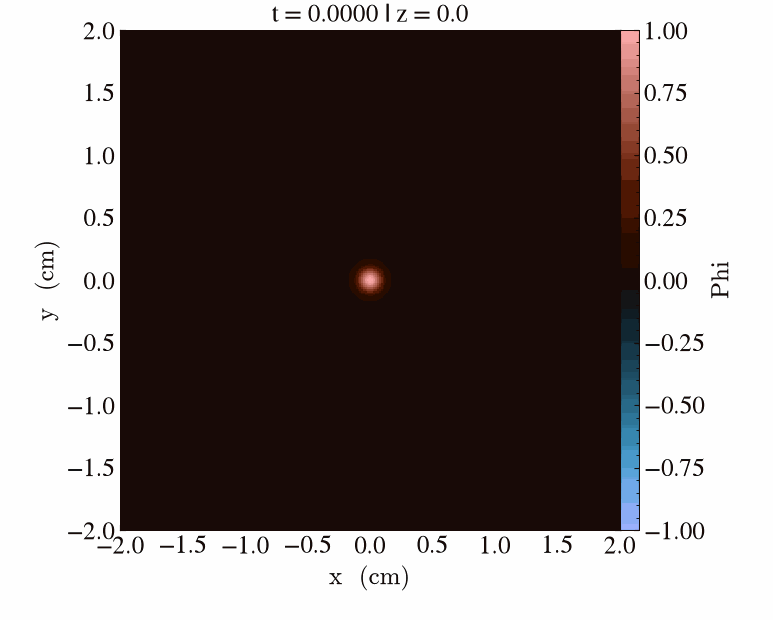

## Example 01 - Wave Equation {#example-01-wave-equation}

Welcome to the first code example, which is meant to illustrate the core features and idiomatic use of the `TreESaP` library. In particular, we will consider how one implements a numerical solver for the scalar wave equation, given by
$$
    \partial_t^2 \phi = \Delta \phi,
$$
using the compile-time tensor aliasing system, finite-difference stencil templates, and the `treesap::RK4Integrator` class provided by the `TreESaP`. 

The code for this example is found in [`examples/01-wave-eqn/`](https://github.com/niels-slotboom/treesap/tree/main/examples/01-wave-eqn/).

### Setting Up the Math Expressions
As a first step, we must break down our second-order continuum equation above into a first-order-in-time system of the form
$$
    \partial_t \Phi = F(\Phi,t).
$$
Instead of the typical choice of defining an auxiliary scalar momentum \f$\pi = \partial_t \phi\f$, we opt to introduce a 3-component vector \f$\mathbf{u}\f$ with components \f$u_a\f$, where \f$a,b,...\f$ denote indices taking the values \f$0,1,2\f$. This might seem arbitrary and inconvenient; it will, however, allow us to use a larger subset of `TreESaP`'s features, making it more suited for this example. 

Using the four variables \f$\Phi = (\phi,\mathbf{u})\f$, we may recast the wave equation into the two first-order equations
\f[
    \begin{aligned}
        \partial_t \phi &= \nabla \cdot \mathbf{u}, \\
        \partial_t \mathbf{u} &= \nabla \phi.
    \end{aligned}
\f]
It is easily verified that under the above first-order equations, \f$\phi\f$ satisfies the wave equation.

To implement this evolution system, we need it in index form, that is, in the form
\f[
    \begin{aligned}
        \partial_t \phi &= \partial_a u_a, \\
        \partial_t u_a &= \partial_a \phi.
    \end{aligned}
\f]
where the Einstein summation convention is employed. The above is why we have chosen the parametrisation \f$(\phi,\mathbf{u})\f$ over the more conventional \f$(\phi,\pi)\f$; using the former gives us both a scalar and a vector, and we have an index contraction—both are `TrEESaP` aspects we wouldn't be able to try out in the latter case.

### Implementing the WaveEqnRHS Functor
In this section, we outline the structure of the right-hand side (RHS) functor implemented in `examples/01-wave-eqn/WaveEqnRHS.hpp`. We begin with the empty `struct` body, and add a check whether `treesap::RHSConcept` is satisfied:
```cpp
#pragma once

#include "pde-model/PDEModelConcepts.hpp"        // <-- for RHSConcept

template <int ngrow_> struct WaveEqnRHS {
    // to be implemented...
};

static_assert(treesap::RHSConcept<WaveEqnRHS<1>>);
```
The template parameter `ngrow_` will define the stencil width, declaring how many neighbouring cells are used in any direction away from a given cell. The `static_assert` line checks if `treesap::RHSConcept` is satisfied in the `ngrow_ = 1` case, and aids us in verifying whether we have given a valid implementation of an `RHSFunctor` which can be used by the `TreESaP` time integrators. This concept checks:
- whether there are `static` `constexpr` members `ngrow` and `ncomp`, providing information about stencil width an the amount of components the right-hand side has (in our case 4);

-  whether `WaveEqnRHS` defines a valid `operator()` implementation, which is marked `const`, has signature `(int i, int j, int k, amrex::Real time, const amrex::Array4<const amrex::Real>& arr) -> amrex::Real`, and is templated upon an integer parameter `comp`. 

The first requirement is straightforward to satisfy: we simply add the lines
```cpp
static constexpr int ncomp = 4; // since we have one scalar and one 3-vector
static constexpr int ngrow = ngrow_; // forward the stencil width the user has selected
```
to the struct body.

The second requirement is more involved, since we need to provide a discretisation of the right-hand sides of the first-order PDE formulation we have written above. To do this, we add the basic signature, as well as another (non-static) member and a constructor to the `WaveEqnRHS` body:
```cpp
amrex::Real dx_inv;

AMREX_GPU_HOST_DEVICE explicit WaveEqnRHS(const amrex::GeometryData& geom) : dx_inv(1.0 / geom.CellSize(0)) {}

template <int comp>
AMREX_GPU_HOST_DEVICE AMREX_FORCE_INLINE amrex::Real operator()(int i, int j, int k, amrex::Real t, const amrex::Array4<const amrex::Real>& arr) const {
    // to be implemented...
}
``` 
There is already a lot going on here, so let us briefly unpack everything.

- The member `dx_inv` is meant to hold the inverse grid spacing \f$1/\Delta x\f$, which is needed to multiply the stencil implementations provided by `namespace treesap::stencil` to approximate derivatives. The `dx_inv` member gets initialised by the constructor.

- The `operator()`'s signature expects:
    + three grid indices `i,j,k`, which refer to the cell for which the current RHS evaluation is carried out;
    + the `time` parameter allows us to implement a possible time-dependence of a PDE's right-hand side; we will not use it, but it is part of the required signature regardless;
    + `arr` is a reference to the chunk of data of which the cell at `(i,j,k)` is part of and which holds the data we need for our computations; 
    + `comp` is a compile-time parameter which determines which of the four equations we are currently dealing with, i.e. `comp = 0` means that we should compute the RHS of \f$\partial_t \phi = ...\f$, whereas `comp = 1,2,3` refer to the respective right-hand sides of \f$\partial_t u_a = ...\f$.
    + The `return` value of the `operator()` call should be the value of the respective RHS, as approximated by a finite-difference discretisation.
    
    It is marked `const` since it should not change the state of the functor; evaluating the RHS of the PDE should not cause `dx_inv` to change.

Implementing this function body might seem daunting, but `TreESaP` puts handy tools at our disposal that make it more or less a 1:1 translation from math to code. The relevant tools here are the `treesap::stencil` `namespace`, and the tensor aliasing system. To make them available, we include the following three files:
```cpp
#include "pde-model/tensor-alias/RankNAlias.hpp" // <-- for ScalarAlias, VectorAlias
#include "util/tensor_operations.hpp"           // <-- for contract()
#include "util/tensor_stencil.hpp"               // <-- for derivative<>()
```
Concretely, the `treesap::stencil` `namespace` provides us with compile-time unrolled implementations of arbitrary-width finite-difference stencil for any first, second and third spatial partial derivative we could need. Instead of having to manually type out a nightmare of indexing arithmetic, we can simply write `treesap::stencil::derivative<ngrow,directions...>(...)`, and the compiler will take care of unrolling an otherwise unreadable finite-difference stencil. The tensor aliasing system&mdash;also resolved fully at compile time&mdash;takes care of the correlation between the flattened `comp` indices and tensor indices, where `comp = 0` should refer to \f$\phi\f$ and `comp = 1,2,3` to \f$u_{\mathtt{comp}-1}\f$&mdash;let us set up the latter first.

To define the alias for the scalar \f$\phi\f$, we add the following lines to the body of the `WaveEqnRHS::operator()` implementation:
```cpp
using namespace treesap;
using namespace tensor;

ScalarAlias<0> phi{{arr}}; // from treesap::tensor
```
A `treesap::tensor::ScalarAlias` is simply a named special case of the more general `treesap::tensor::RankNAlias` tensor alias implementation for the `N = 0` case. Its template parameter is the value of `comp` where its indexing range starts; for the first field in a general variable vector \f$\Phi\f$, this is always 0. We call the `treesap::tensor::ScalarAlias` `phi`, since that is the name of the field we are aliasing. Lastly, we pass the initialiser list `{{arr}}` to initialise `phi`, so that it knows where the data is which it is aliasing. 

To add an alias for the vector field \f$\mathbf{u}\f$, we use a `VectorAlias` as follows:
```cpp
VectorAlias<phi.next> u{{arr}};
```
This functions similarly to `phi`, but instead of manually specifying the starting index, we use `phi.next` which is a `constexpr` member which in this case will evaluate to `1`; in general, it evaluates to the first `comp` value which is no longer aliased by `phi`, and can hence be used for the next field. 

As a sanity check, we should verify that we do indeed have the correct total amount of aliased `comp` values, that is, we should assert
```cpp
static_assert(u.next == ncomp);
```
This leaves us with the following `operator()`:
```cpp
template <int comp>
AMREX_GPU_HOST_DEVICE AMREX_FORCE_INLINE amrex::Real operator()(int i, int j, int k, amrex::Real t, const amrex::Array4<const amrex::Real>& arr) const {
    // import namespaces for more concise code
    using namespace treesap;
    using namespace tensor;

    // set up the aliases for field variables:
    ScalarAlias<0> phi{{arr}};      // component range {0}
    VectorAlias<phi.next> u{{arr}}; // component range {1,2,3}
    static_assert(u.next == ncomp); // ensure that we have the correct amount of components

    // to be implemented...
}
```
Next, we set up the (compile-time resolved) branching for the different components of the PDE's RHS. For this, tensor aliases implement a `constexpr` `.contains(int comp)` function, which evaluates to `true` iff the given `comp` is a component being aliased by the given alias. For example, for `phi`, `.contains(int comp)` evaluates to `true` only for `comp = 0`. We use these functions in an `if constexpr` decision tree:
```cpp
// if constexpr to decide which field comp belongs to
if constexpr (phi.contains(comp)) { 
    // phi_rhs : to be implemented...
} else if constexpr (u.contains(comp)) { 
    // u_rhs: to be implemented...
} else {
    return NAN; // this should never be reached
}
```
Adding this to the `operator()` body means that the `phi_rhs` is reached only if `comp` is the component aliased by `phi`&mdash;i.e., 0&mdash;, and `u_rhs` is reached only if `comp` is one of the three components `1,2,3` aliased by `u`. 

The `phi_rhs` branch should return a discretisation of \f$\partial_t \phi = \partial_a u_a\f$, that is, the contraction of the first derivative \f$\partial_a u_b\f$. Together with the `tensor_operations.hpp` include, the `treesap::stencil` `namespace` allows us to do this as
```cpp
using namespace stencil;

contract([&]<int a>() { return derivative<ngrow, a>(i, j, k, u, {a}); });
```
The outer call to `treesap::tensor::contract()` expects a lambda expression returning an `amrex::Real`, which it evaluates for `a = 0,1,2` and sums up. Inside the lambda, we must compute the (unsummed) discretisation \f$\partial_a u_a\f$, which we do by calling `treesap::stencil::derivative<>()`. Its arguments are as follows:

+ `ncomp` sets the stencil width to whatever the user has configured;
+ the single additional template argument `int a` specifies that we are taking a first-order derivative along the direction `a`, that is, we are computing a discretised \f$\partial_a\f$;
+ `i,j,k` are the indices of the cell at which the stencil is centered;
+ passing `u` specifies that we are taking a derivative of the vector field `u`;
+ `{a}` is the index (array) which specifies the component of which we are taking a derivative.

To make this a valid approximation of \f$\partial_a u_a\f$, we need to remember to multiply by `dx_inv` before returning.

Turning our attention to the RHS for \f$\mathbf{u}\f$, that is, \f$\partial_t u_a = \partial_a u\f$, we can simply use `stencil::derivative<>()`, but this time, we have to restore the vector index `a` from `comp`. The tensor aliasing system provides functions for this: calling `u.restore_absolute(comp)` gives us the index (array) which tells us the component of `u` which `comp` is referring to. We hence implement this branch as
```cpp
// restore vector index into constexpr int a so we can use it as a template argument
constexpr auto restored = u.restore_absolute(comp);
constexpr int a = restored[0];

return dx_inv * derivative<ngrow, a>(i, j, k, phi, {/*no indices*/}); // = ∂ₐφ(i,j,k)
```
Putting all of the above together, we arrive at the `operator()` implementation
```cpp
template <int comp>
AMREX_GPU_HOST_DEVICE AMREX_FORCE_INLINE amrex::Real operator()(int i, int j, int k, amrex::Real t, const amrex::Array4<const amrex::Real>& arr) const {
    // import namespaces for more concise code
    using namespace treesap;
    using namespace tensor;
    using namespace stencil;

    // set up the aliases for field variables:
    ScalarAlias<0> phi{{arr}};      // component range {0}
    VectorAlias<phi.next> u{{arr}}; // component range {1,2,3}
    static_assert(u.next == ncomp); // ensure that we have the correct amount of components

    // constexpr if to decide which field comp belongs to
    if constexpr (phi.contains(comp)) { // phi_rhs implementation
        return dx_inv * contract([&]<int a>() { return derivative<ngrow, a>(i, j, k, u, {a}); }); // = ∂ₐuᵃ(i,j,k)

    } else if constexpr (u.contains(comp)) { // u_rhs implementation
        // restore vector index into constexpr int a so we can use it as a template argument
        constexpr auto restored = u.restore_absolute(comp);
        constexpr int a = restored[0];

        return dx_inv * derivative<ngrow, a>(i, j, k, phi, {/*no indices*/}); // = ∂ₐφ(i,j,k)
    } else {
        return NAN; // this should never be reached
    }
}
```
Before moving on to use this `WaveEqnRHS` implementation to integrate the wave equation, let us briefly appreciate what the above does. Given any (positive) value of `ngrow`, the compiler turns the code we have written into fully unrolled stencils and index contractions, handling the `comp` indexing on the fly. Meanwhile, we ourselves have never had to bother writing out a stencil by hand, or dealing with the flattened one-dimensional layout of the `comp` list. Instead, we have written code that is roughly isomorphic to the math; we have listed the variables \f$(\phi,\mathbf{u})\f$ in the form of aliases, and used `treesap::stencil::derivative<>()` and `treesap::tensor::contract()` to represent the mathematical notions of the derivatives and index contractions that appear in the PDE system's right-hand sides. 

### Setting Up a PDE Model
Although the PDE's right-hand side is arguably one of the most involved parts in building a numerical solver, it does not constitute its entirety. In addition to the RHS, we need to specify its domain and its initial as well as boundary conditions. This information is suitably encompassed in the `treesap::PDEModel` class, which is what is passed to a concrete `treesap::Integrator`-implementing instance to integrate. More generally speaking, the `treesap::Integrator` virtual class is templated upon a type satisfying the `treesap::PDEModelConcept`, allowing the user to define custom `PDEModel` classes&mdash;but here, we use the built-in `treesap::PDEModel`. 

In this section, we set up a `treesap::PDEModel` with function-based initial data (`treesap::FunctionInit`) and Dirichlet boundary conditions (`treesap::DirichletBC`).

We begin by creating a new file, `main.cpp`, and adding a basic `AMReX`-style `main`:
```cpp
#include <AMReX.H>

int main(int argc, char** argv) {
    amrex::Initialize(argc, argv);
    {
        // to be implemented ...
    }
    amrex::Finalize();
}
```
All of the code in the following (except for includes) will be added to the scope between the `amrex::Initialize()` and `amrex::Finalize()` calls.
Our first step is to set up the domain. We opt for a \f$[-2,2]^3\f$ cube in Cartesian coordinate space, with a resolution of \f$256^3\f$. For this, we need the following includes:
```cpp
#include "AMReX_Box.H"
#include "AMReX_CoordSys.H"
#include "AMReX_Geometry.H"
#include "AMReX_RealBox.H"
```
With these, we set up the domain in the form of an `amrex::Geometry` object named `geom` as follows:
```cpp
amrex::Box index_range{{0, 0, 0}, {256, 256, 256}};              // 256³ resolution
amrex::RealBox coord_range{{-2.0, -2.0, -2.0}, {2.0, 2.0, 2.0}}; // coordinate domain [-2,2]³
int is_per[] = {0, 0, 0};                                        // no periodic boundaries
amrex::Geometry geom(index_range, &coord_range, amrex::CoordSys::cartesian, is_per);
```
The `is_per` array filled with zeros tells `AMReX` that none of our domain boundaries are periodic; we will use Dirichlet boundary conditions. 

Now that we have defined the domain, we can quickly follow it up with a definition of the grid spacing `dx` and the CFL-bound timestep `dt`, as well as specifying the compile-time constant `ngrow` which sets the stencil width:
```cpp
constexpr int ngrow = 1;
amrex::Real dx = geom.CellSize(0);
amrex::Real dt = std::sqrt(8.0 / 3.0) * dx; // we will use RK4, which at ngrow = 1 has this as a CFL bound in 3d
```
*Note: when experimenting with different* `ngrow` *values, the spectrum of the RHS operator changes, and the CFL bound needs to be adjusted accordingly. The same holds for changing to an integrator other than RK4, since the stability region will change.*

Though not strictly necessary, for better readability, we can introduce a few type aliases for the RHS, initialisation, boundary condition and `treesap::PDEModel` types to make code more readable down the line. To this end, we have to first include the files that define these types:
```cpp
// TreESaP includes
#include "init/FunctionInit.hpp"
#include "pde-model/PDEModel.hpp"
#include "pde-model/bcs/DirichletBC.hpp"

// our files
#include "WaveEqnRHS.hpp"
```
We then alias the relevant types as
```cpp
using RHSType = WaveEqnRHS<ngrow>;                      // our custom wave equation RHS implementation
using InitType = treesap::FunctionInit<RHSType::ncomp>; // initialisation with function expressions in strings;
                                                        // RHS dictates ncomp
using BCType = treesap::DirichletBC<RHSType::ncomp,
                                    RHSType::ngrow>; // Dirichlet boundaries with RHS-dictated ncomp and ngrow
using ModelType = treesap::PDEModel<RHSType, InitType, BCType>;
```
For our `RHSType`, we use our custom-implemented `WaveEqnRHS`, with the compile-time constant `ngrow` as the stencil width. The `InitType` `FunctionInit` needs to know how many components are to be populated, whence it is templated upon an `ncomp` parameter; this is set by `RHSType::ncomp`, in this case evaluating to 4. Then, the `BCType` `DirichletBC` needs to know both how many components we have, and how wide the external boundary halo is&mdash;given by `RHSType::ngrow`.

To create instances of these types with the correct parameters and to put them together into a `ModelType model`, we simply call their constructors:
```cpp
RHSType rhs(geom.data());                                              // RHS of the bulk PDE, without ABL terms
InitType init({"exp(-(x^2 + y^2 + z^2)/0.1^2)", "0.0", "0.0", "0.0"}); // functions used to initialise fields
BCType bc{0.0, 0.0, 0.0, 0.0};                                         // boundary values set to 0
ModelType model({"phi", "u_0", "u_1", "u_2"}, std::move(geom), dt, std::move(rhs), std::move(init),
                std::move(bc));

```
The chosen math expressions for `init` create an initially stationary Gaussian profile; the array of zeros passed to `bc` means that the constant boundary value for each component is zero.

We now have a `model` ready to be passed into a `treesap::Integrator` implementation.

### Integrating the PDE Model
To integrate the PDE defined by `model`, we must pass it to a derived `treesap::Integrator` implementation. We use the `TreESaP` library's `treesap::RK4Integrator` implementation, which we make available using the following include:
```cpp
#include "integrators/RK4Integrator.hpp"
```
We instantiate and initialise the integrator with
```cpp
treesap::RK4Integrator<ModelType> integrator(std::move(model), {128, 128, 128});
integrator.initialise();
```
Here, the second argument sets the maximum box size for the internal `amrex::MultiFab` storage; since our domain has the index size \f$256^3\f$, this implies that it is split up into eight \f$128^3\f$-sized boxes. The call to `.initialise()` uses the `treesap::FunctionInit` functor to populate the initial state of the fields. 

Next, we set up the export of every second timestep, starting at zero, to `raw/wave_eqn` using
```cpp
integrator.configureExporter("raw/wave_eqn", 2);
```
This causes timesteps \f$0,2,4,...\f$ to have their state exported as plotfiles (through internal calls to `amrex::WriteSingleLevelPlotfile`). The contents of timestep \f$0\f$ correspond to the initial state.

Using the include 
```cpp
#include "util/ScopedTimer.hpp"
```
we can enable basic profiling output:
```cpp
treesap::ScopedTimer::enabled = true;
```
This will trigger a timing readout for various aspects of the integration loop. 

To finally integrate the PDE, we employ a simple loop, going up to 70 steps:
```cpp
for (size_t step = 0; step <= 70; ++step) {
    integrator.step();
}
```
The reason we choose 70 steps is simply due to the fact that right after step 70, the radially-outward-travelling wavefront reaches the boundary, which in the given implementation causes non-physical grid-scale modes to emerge. Of course, this means that our setup is, mathematically speaking, unsuited to integrate the wave equation; at this point, however, we should recall that this guide is meant to illustrate as many basic `TreESaP` principles and idioms as possible, not to be mathematically perfect. 

After completion of the integration loop, we can print a profiling summary:
```cpp
if (treesap::ScopedTimer::enabled) {
    treesap::ScopedTimer::printOverview();
}
```
### Relishing in the Results
Running the code we have developed in the above should lead to the following simulation output:
{width=600}